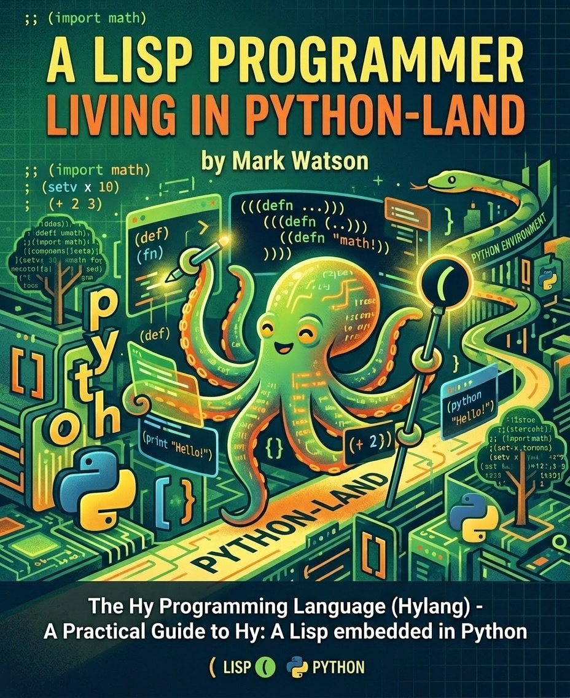

# Manuscript and Example Code for my book "A Lisp Programmer Living in Python-Land: The Hy Programming Language"

The code examples have been updated in November 2026 to run with Hy version 1.3.1 (`hy>=1.3.1`) and Python 3.12–3.15 using `uv`.



## Code examples

The examples are in the directory **hy-lisp-python-book/source_code_for_examples**.

I am in the process of adding new examples (macros, modern Hy tooling, async, LLM evaluation, MCP, and GraphRAG) and deprecating old examples. The old examples will be moved to the directory **hy-lisp-python-book/source_code_for_examples/OLD_EXAMPLES_NO_LONGER_IN_BOOK** and removed from the book.

As I am updating this book in November 2026, the latest version of Hy is 1.3.1:

```
$ uv run hy
Hy 1.3.1 (Eyes in the Sky) using CPython(main) 3.14.7 on Darwin
=> 
```

You can purchase the book at [leanpub](https://leanpub.com/hy-lisp-python) or read the book online for free. I offer free updates to new editions to all of my books purchased on leanpub.

## Book Content

This book covers many programming topics using the Lisp language Hy that compiles to Python AST and is compatible with code, libraries, and frameworks written in Python. The main topics we will cover and write example applications for are:

- Lisp Macros, Reader Macros, and Domain-Specific Languages (DSLs)
- Modern Hy 1.3, Packaging (`uv`), Type Checking (`hy2py` + `mypy`), and Testing (`pytest`)
- Asynchronous and Concurrent Programming (`asyncio`, `httpx`, Streaming LLMs)
- Relational and graph databases
- Web app development
- Web scraping
- Accessing semantic web and linked data sources like Wikipedia, DBpedia, and Wikidata
- Automatically constructing Knowledge Graphs from text documents, semantic web and linked
data
- Deep Learning
- Natural Language Processing (NLP) using Deep Learning
- OpenAI, Google Gemini, Perplexity, and local Ollama LLM APIs
- LangChain and Agno agents
- Evaluating and Operating LLM Applications (eval harnesses, tracing, structured outputs, guardrails)
- Model Context Protocol (MCP) Servers and Clients
- Neural-Symbolic Knowledge Graphs (NSK), SHACL Validation, and GraphRAG

Please note that this repo may also occasionally contain examples that are a work in progress (these directories contain a file named **NOT_YET_IN_BOOK.md**).

## Support My Work

If you would like to support my work please consider:

- Hire me as a consultant: [https://markwatson.com](https://markwatson.com).
- Purchasing my books on Leanpub: [https://leanpub.com/u/markwatson](https://leanpub.com/u/markwatson).
- Star my git repositories that you find useful on GitHub: [https://github.com/mark-watson?tab=repositories](https://github.com/mark-watson?tab=repositories).

You can also interact with me on social media: Mastodon [https://mastodon.social/@mark_watson](https://mastodon.social/@mark_watson) and X/Twitter [https://x.com/mark_l_watson](https://x.com/mark_l_watson).
