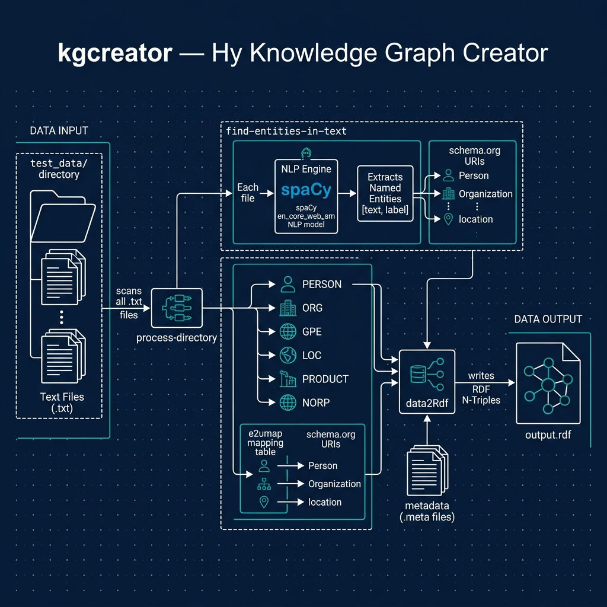

# Knowledge Graph Creator

**Book Chapter:** [Knowledge Graph Creator](https://leanpub.com/read/hy-lisp-python/leanpub-auto-knowledge-graph-creator) — *A Lisp Programmer Living in Python-Land* (free to read online).

This example automatically constructs **RDF-style knowledge graph triples** (subject → predicate → object) from plain-text documents using spaCy NLP. Two scripts are provided:

- **`kgcreator.hy`** — generates triples with simple string labels. Start here.
- **`kgcreator_uri.hy`** — generates triples using DBpedia URIs for entities, producing linked-data-friendly output. Read the minor limitations noted in the book before using this version.



## Prerequisites

- [uv](https://docs.astral.sh/uv/) package manager

## Initial Setup

Download the spaCy English language model (one-time step):

```bash
uv sync
uv run python -m spacy download en_core_web_sm
```

## Running the Examples

```bash
uv run hy kgcreator.hy
uv run hy kgcreator_uri.hy
```

## Running the Tests

The tests are written in Hy in `test_kgcreator.hy`. Run them with:

```bash
uv run pytest
```

These tests need the spaCy model (`uv run python -m spacy download en_core_web_sm`). If the model is not installed, the tests that need it are skipped. The tests run both `kgcreator.hy` and `kgcreator_uri.hy` over the files in `test_data/` and write the RDF output to a temporary directory.

By default pytest does not collect `.hy` files, so `conftest.py` adds a small hook that tells it to collect any file named `test_*.hy`. To add more tests, create another `test_*.hy` file or add `test-` functions to `test_kgcreator.hy`.
