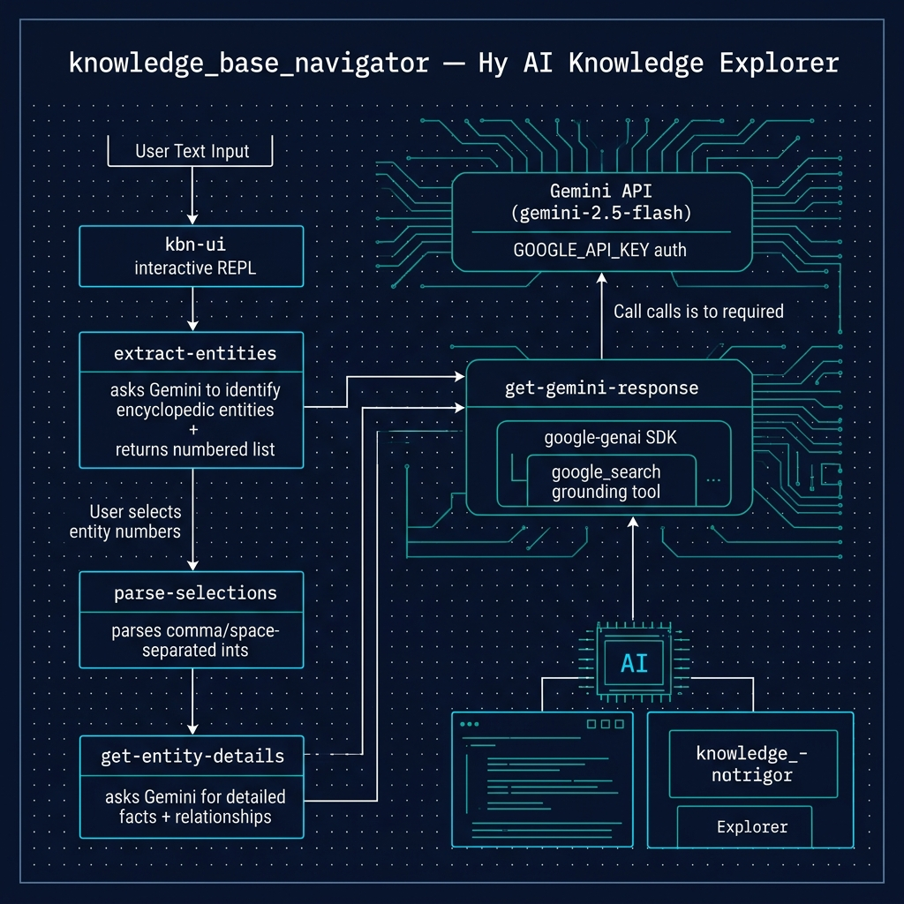

# Knowledge Base Navigator

**Book Chapter:** [Knowledge Base Navigator](https://leanpub.com/read/hy-lisp-python/leanpub-auto-knowledge-base-navigator-building-an-ai-powered-information-system) — *A Lisp Programmer Living in Python-Land* (free to read online).

An AI-powered interactive knowledge exploration tool. Uses Google's Gemini API with web search grounding to extract entities from natural language, then retrieves detailed encyclopedic information and discovers relationships between selected entities.

This is a modern evolution of the KGN (Knowledge Graph Navigator) example — replacing SPARQL/DBPedia queries with an AI-driven pipeline powered by Gemini.



## Prerequisites

- [uv](https://docs.astral.sh/uv/) package manager
- `GOOGLE_API_KEY` environment variable set with your Google AI API key

## Running

```bash
uv sync
uv run hy knowledge_base_navigator.hy
```

Then enter entity names or descriptive sentences at the prompt. The navigator will identify entities, let you select which ones to explore, and provide detailed facts and relationship analysis.

## Running the Tests

The tests are written in Hy in `test_knowledge_base_navigator.hy`. Run them with:

```bash
uv run pytest
```

No API key or network access is needed: the Gemini client and keyboard input are replaced with fakes, and `conftest.py` sets a placeholder `GOOGLE_API_KEY` because `genai.Client()` is created when the module is imported.

By default pytest does not collect `.hy` files, so `conftest.py` adds a small hook that tells it to collect any file named `test_*.hy`. To add more tests, create another `test_*.hy` file or add `test-` functions to `test_knowledge_base_navigator.hy`.
