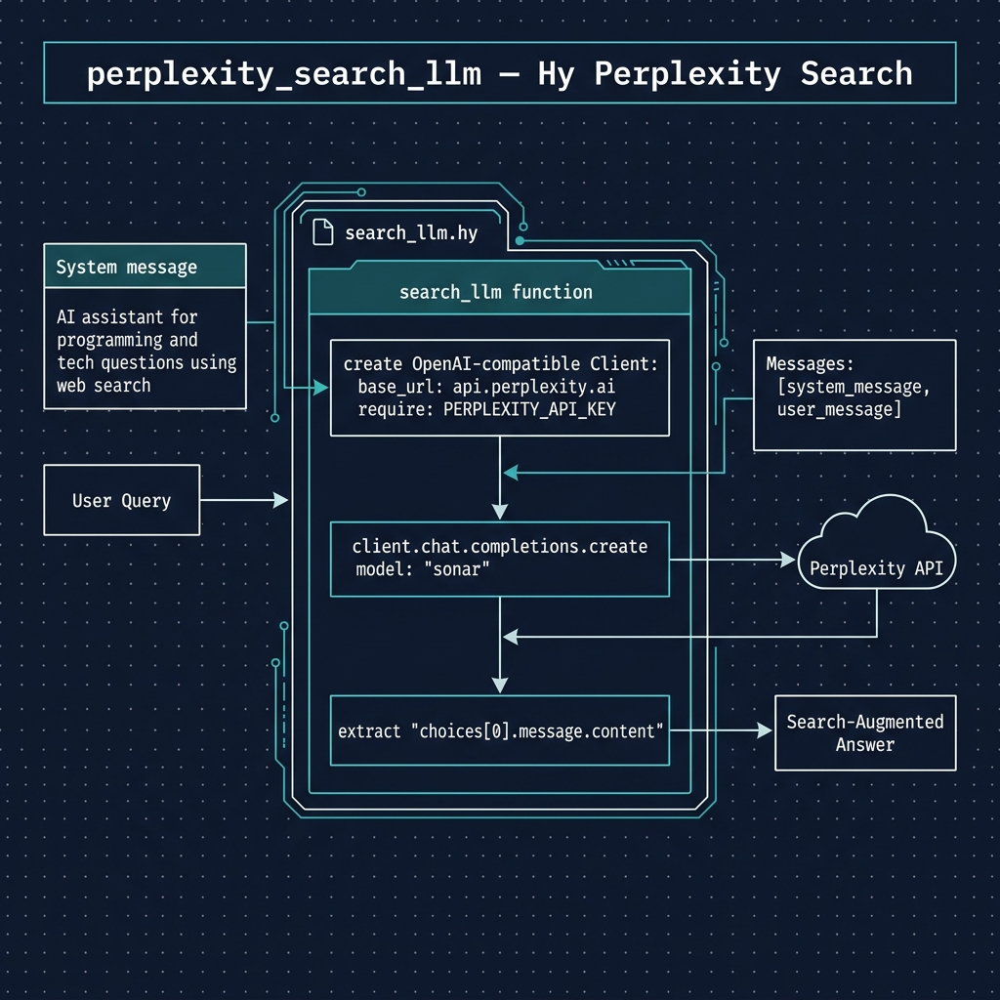

# Perplexity Sonar Combined Search and LLM Example

**Book Chapter:** [Using Perplexity Sonar Model for Combined Web Search and LLM Based Reasoning](https://leanpub.com/read/hy-lisp-python/leanpub-auto-using-perplexity-sonar-model-for-combined-web-search-and-llm-based-reasoning) — *A Lisp Programmer Living in Python-Land* (free to read online).

This example uses the [Perplexity Sonar](https://docs.perplexity.ai/home) model to combine live web search with LLM-based reasoning in a single API call. The script sends a natural-language question, and Sonar searches the web and synthesizes a cited answer.



## Prerequisites

- [uv](https://docs.astral.sh/uv/) package manager
- A Perplexity API key set as the `PERPLEXITY_API_KEY` environment variable
  - Get a key at [docs.perplexity.ai](https://docs.perplexity.ai/home)
  - [Pricing info](https://docs.perplexity.ai/guides/pricing) — $5 of credits lasts a long time for casual use

## Running the Example

```bash
uv sync
uv run hy search_llm.hy
```

## Running the Tests

The tests are written in Hy in `test_search_llm.hy`. Run them with:

```bash
uv run pytest
```

No API key or network access is needed: `openai.OpenAI` is replaced with a fake that records the endpoint, model and messages it receives.

By default pytest does not collect `.hy` files, so `conftest.py` adds a small hook that tells it to collect any file named `test_*.hy`. To add more tests, create another `test_*.hy` file or add `test-` functions to `test_search_llm.hy`.
