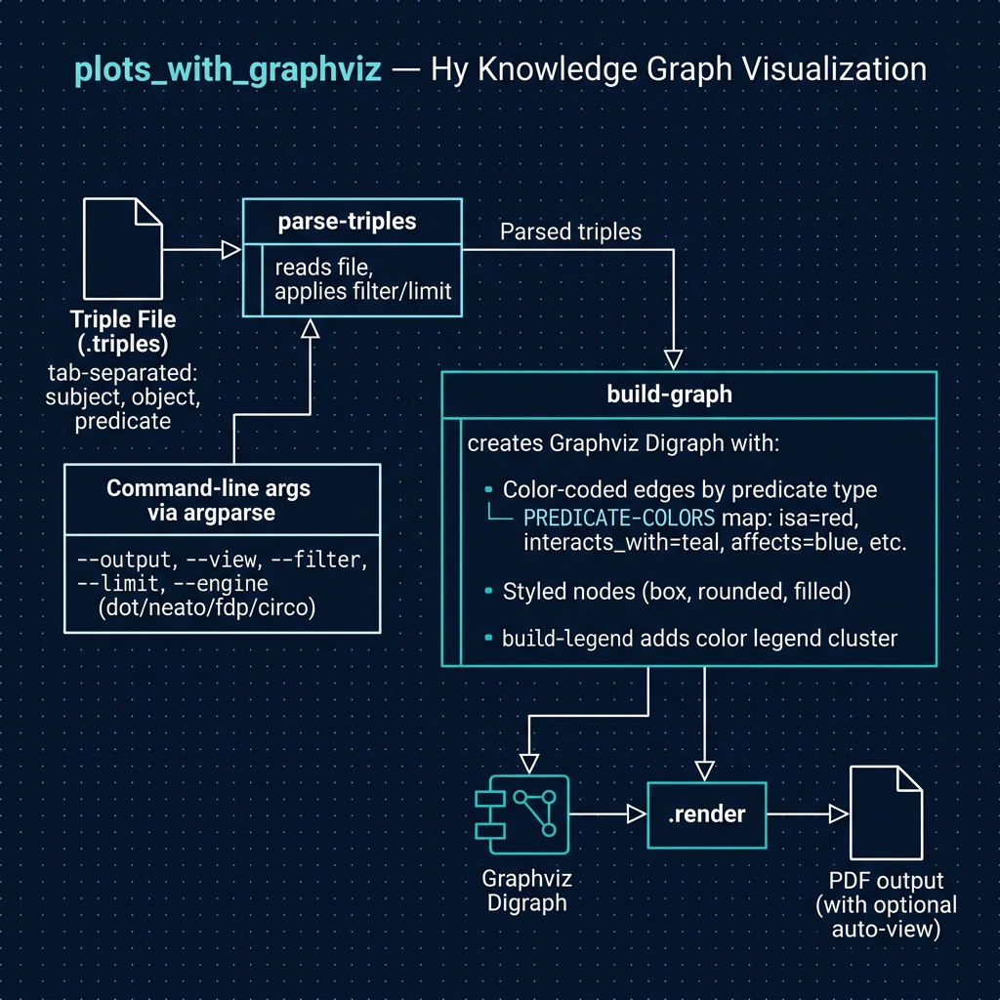

# Knowledge Graph Visualization with GraphViz

**Note:** This example is **not yet covered in the book** but is useful for learning to use GraphViz from Hy programs.

This script reads RDF-style triple data from `test.triples` (a subset from the [Salesforce MultiHopKG](https://github.com/salesforce/MultiHopKG) project containing UMLS medical-ontology relationships) and renders it as a graph using [GraphViz](https://graphviz.org/), producing a PDF visualization.



## Prerequisites

- [uv](https://docs.astral.sh/uv/) package manager
- [GraphViz](https://graphviz.org/) installed on your system (`brew install graphviz` on macOS)

## Running the Example

```bash
uv sync
uv run hy UMLS_graph.hy
```

This generates `umls_graph.pdf` in the current directory.

## Running the Tests

The tests are written in Hy in `test_umls_graph.hy`. Run them with:

```bash
uv run pytest
```

The tests check triple parsing, filtering, command-line options and the generated DOT source, so the Graphviz `dot` program does not need to be installed.

By default pytest does not collect `.hy` files, so `conftest.py` adds a small hook that tells it to collect any file named `test_*.hy`. To add more tests, create another `test_*.hy` file or add `test-` functions to `test_umls_graph.hy`.
