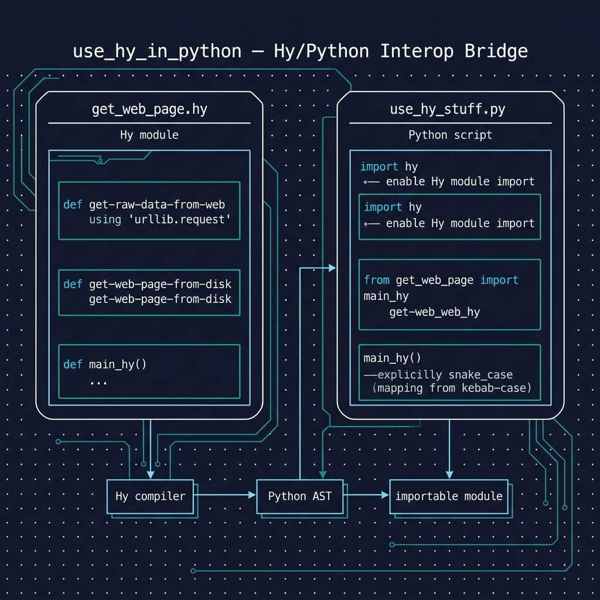

# Using Hy Code from Python

**Book Chapter:** [Introduction to the Hy Language](https://leanpub.com/read/hy-lisp-python/leanpub-auto-introduction-to-the-hy-language) — *A Lisp Programmer Living in Python-Land* (free to read online).

This example demonstrates one of Hy's most powerful features: **seamless interop with Python**. The Hy module `get_web_page.hy` defines functions for fetching web pages, and the Python script `use_hy_stuff.py` imports and calls them directly — showing that Hy modules are first-class Python modules.



## Prerequisites

- [uv](https://docs.astral.sh/uv/) package manager

## Running the Example

```bash
uv sync

# Run the Hy module directly
uv run hy get_web_page.hy

# Or call Hy functions from Python
uv run python use_hy_stuff.py
```

Both commands fetch and print the HTML content of a web page.

## Running the Tests

The tests are in `test_get_web_page.py`. Run them with:

```bash
uv run pytest
```

The tests are written in plain Python rather than Hy, as one more example of using Hy from Python: after `import hy`, `get_web_page.hy` is imported and tested like any Python module, with Hy names such as `get-raw-data-from-web` available as `get_raw_data_from_web`. `urlopen` is replaced with a fake, so no network access is needed.
