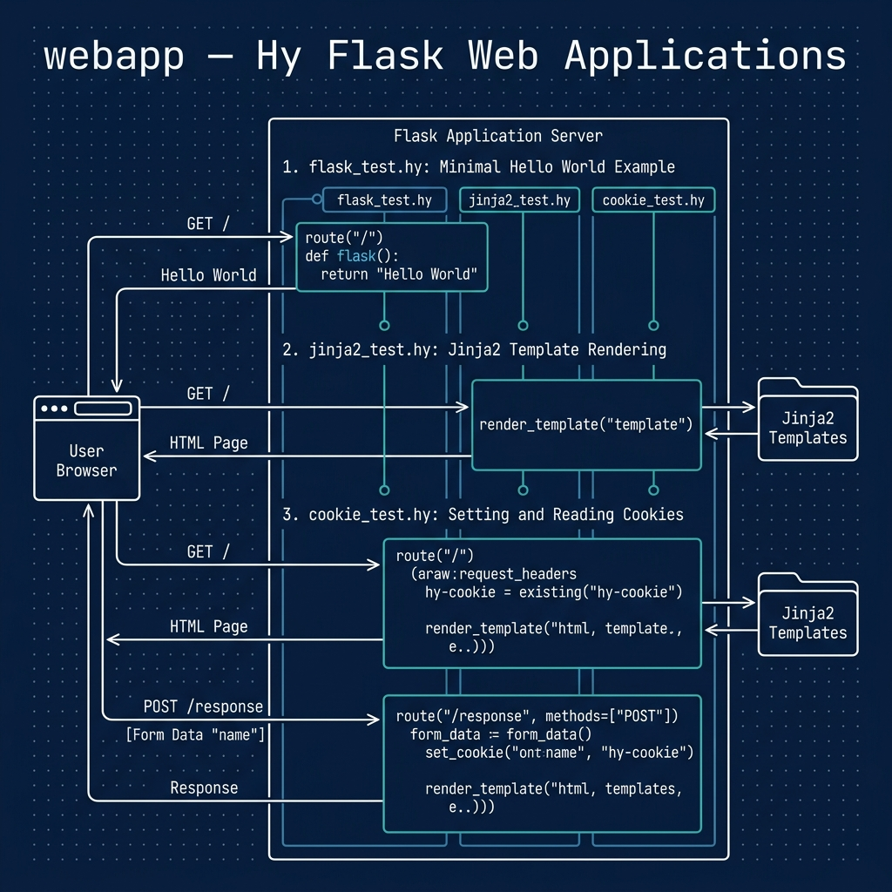

# Writing Web Applications

**Book Chapter:** [Writing Web Applications](https://leanpub.com/read/hy-lisp-python/leanpub-auto-writing-web-applications) — *A Lisp Programmer Living in Python-Land* (free to read online).

This directory contains three progressively richer [Flask](https://flask.palletsprojects.com/) web application examples written in Hy:

- **`flask_test.hy`** — minimal "Hello World" Flask app.
- **`jinja2_test.hy`** — adds Jinja2 HTML templates and a form that accepts user input.
- **`cookie_test.hy`** — extends the Jinja2 example with cookie handling.



## Prerequisites

- [uv](https://docs.astral.sh/uv/) package manager

## Running the Examples

```bash
uv sync

# Start any of the three servers (each runs on http://127.0.0.1:5000):
uv run hy flask_test.hy
uv run hy jinja2_test.hy
uv run hy cookie_test.hy
```

Open `http://127.0.0.1:5000` in your browser after starting a server.

## Running the Tests

The tests are written in Hy in `test_webapp.hy`. Run them with:

```bash
uv run pytest
```

No server is started: each app is exercised with Flask's built-in test client. `conftest.py` makes this directory the current directory so Flask can find `templates/`.

By default pytest does not collect `.hy` files, so `conftest.py` adds a small hook that tells it to collect any file named `test_*.hy`. To add more tests, create another `test_*.hy` file or add `test-` functions to `test_webapp.hy`.
